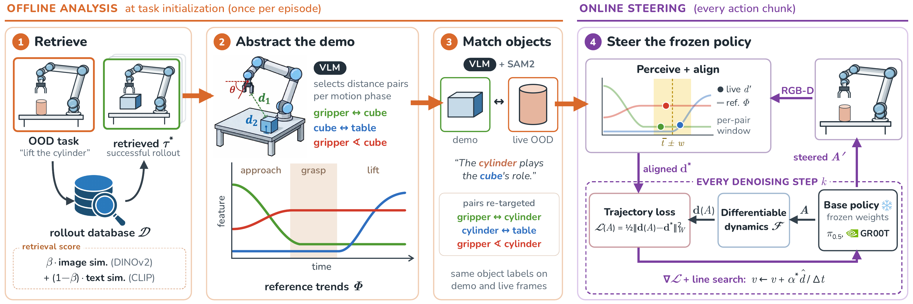

<div align="center">

# VG-Steer: Visual-Geometric Policy Steering from In-Context Aligned Abstractions

[Arthur Bucker](https://arthurfenderbucker.github.io/)<sup>1</sup>, [Pramod Anantharam](https://scholar.google.com/citations?user=yQ52qVkAAAAJ&hl=en)<sup>2</sup>, [Jonathan Francis](https://jonfranc.com/)<sup>1,2</sup>, [Jean Oh](https://www.cs.cmu.edu/~jeanoh/)<sup>1,3</sup>

<sub><sup>1</sup>Robotics Institute, Carnegie Mellon University &nbsp;·&nbsp; <sup>2</sup>Robot Learning Lab, Bosch Center for Artificial Intelligence &nbsp;·&nbsp; <sup>3</sup>Lavoro AI</sub>

[](https://arthurfenderbucker.github.io/VG-Steer/)
[](https://arxiv.org/abs/2611.25199)
[](https://arthurfenderbucker.github.io/VG-Steer/#video)

</div>

Official code release for VG-Steer. Test-time steering of frozen robotic manipulation policies toward
out-of-distribution (OOD) scenes — without retraining or fine-tuning.

## Overview

Pre-trained robot policies degrade when deployed in environments that differ
from their training distribution. This framework adapts such policies at
inference time by injecting a differentiable guidance signal into the
denoising process of flow-matching policies (pi0.5 via
[OpenPI](https://github.com/Physical-Intelligence/openpi) and LeRobot, and
[GR00T N1.7](https://github.com/NVIDIA/Isaac-GR00T)). The policy weights stay
frozen; only the velocity field is reshaped during denoising.

The core idea: retrieve a successful in-distribution rollout, let a
vision-language model (VLM) pick which *object-relational distances* matter
in it, align the live scene to that reference in distance space, and steer the
policy so the live distances follow the reference trends.

<p align="center">
  
</p>

See [`docs/codebase_overview.md`](docs/codebase_overview.md) for the method pipeline, project structure, and scripts.

## Getting Started

Full walkthrough: **[`docs/SETUP.md`](docs/SETUP.md)**. Quick start on a
fresh machine:

```bash
# 1. Clone (packages/open_perception is vendored in this release)
git clone https://github.com/arthurfenderbucker/VG-Steer.git policy_abstraction
cd policy_abstraction

# 2. Heavy-storage symlinks (one-time per machine)
export POLICY_ABSTRACTION_STORAGE="$HOME/policy_abstraction_storage"
mkdir -p "$POLICY_ABSTRACTION_STORAGE"/{data,datasets,checkpoints}
ln -s "$POLICY_ABSTRACTION_STORAGE"/{data,datasets,checkpoints} .

# 3. Root environment
cp .env.example .env && $EDITOR .env   # set OPENAI_API_KEY (or OPENROUTER_API_KEY)
uv sync

# 4. Install the simulator + one policy (see docs/SETUP.md §4-§5)
# 5. Run evaluation
uv run python scripts/evaluate.py --env.task-suite-name libero_spatial
```

CLI arguments are managed via [tyro](https://github.com/brentyi/tyro) and grouped
into nested dataclasses (see `Args` in [scripts/evaluate.py](scripts/evaluate.py)).
Every flag lives under a group: `--policy.*`, `--env.*`, `--env.perturb.*`,
`--camera.*`, `--iter.*`, `--retrieval.*`, `--demo-analysis.*`, `--guidance.*`,
`--alignment.*`, `--subtraj.*`, `--perception.*`, `--viz.*`, `--output.*`. See
all options with:

```bash
python scripts/evaluate.py --help
```

### Key Configuration Flags

| Flag | Default | Description |
|---|---|---|
| `--env.task-suite-name` | `libero_spatial` | LIBERO task suite to evaluate |
| `--env.perturb.swap / .object / ...` | swap only | OOD perturbation types to apply |
| `--retrieval.enable` | `True` | Retrieve in-distribution demos for guidance |
| `--demo-analysis.enable` | `True` | VLM-based distance-pair selection + feature extraction |
| `--guidance.enable` | `True` | Apply differentiable guidance gradients |
| `--guidance.factor` | `1.0` | Guidance signal strength |
| `--perception.mode` | `REAL_PERCEPTION` | Live point-cloud source (`GT_POINTCLOUD`, `GT_SEG_RECONSTRUCT`, `REAL_PERCEPTION`) |
| `--alignment.mode` | `MIXED` | Temporal alignment strategy (`UNIFIED`, `PER_FEATURE`, `MIXED`) |
| `--iter.num-trials-per-task` | `1` | Episodes per task |
| `--policy.replan-steps` | `5` | Steps between policy re-planning |

### Data Preparation

Before running retrieval-based evaluation, encode your demonstration datasets:

```bash
python scripts/encode_datasets.py --dataset-dir <path-to-hdf5-demos>
```

This produces `*_embeddings.npz` files used by the retrieval index.

### Third-Party Setup

Third-party simulators and policies live in `third_party/` (cloned per
simulator/policy, each with its own venv). See:

- **[`docs/SETUP.md`](docs/SETUP.md)** — canonical end-to-end setup walkthrough
- [`docs/install_libero_pro.md`](docs/install_libero_pro.md) + [`docs/libero_pro_setup.md`](docs/libero_pro_setup.md) — LIBERO-PRO
- [`docs/install_openpi.md`](docs/install_openpi.md) — OpenPI (pi0.5) policy server
- [`docs/install_groot.md`](docs/install_groot.md) — GR00T N1.7 policy + checkpoints
- [`docs/libero_pro_eval_commands.md`](docs/libero_pro_eval_commands.md) — Example evaluation commands
- [`docs/ur5.md`](docs/ur5.md) — real UR5e arm (driver + LeRobot pi0.5 policy server)
- [`docs/install_lerobot.md`](docs/install_lerobot.md) — LeRobot (pi0.5) policy server used on the real robot
- [`docs/real_deployment.md`](docs/real_deployment.md) — bringing the real cell up
- [`docs/real_experiments.md`](docs/real_experiments.md) — operator-driven experiments: staging grid, hotkeys, resume, reports
- [`docs/demo.md`](docs/demo.md) — live guidance demo on the UR5e

## Tests

```bash
uv run pytest              # all tests
uv run pytest -m "not slow"  # skip slow tests
FORCE_CPU=1 uv run pytest  # force CPU (no CUDA)
```

Test markers: `slow`, `integration` (requires HDF5/network/simulator), `gpu` (requires CUDA).

## Key Dependencies

- **Policies:** [OpenPI](https://github.com/Physical-Intelligence/openpi) (pi0.5, simulation), [GR00T N1.7](https://github.com/NVIDIA/Isaac-GR00T) (simulation), [LeRobot](https://github.com/huggingface/lerobot) (pi0.5, real robot)
- **Simulator:** [LIBERO-PRO](https://github.com/Zxy-MLlab/LIBERO-PRO)
- **Perception:** SAM3 / SAM2 segmentation and tracking, DINOv2 / CLIP retrieval embeddings
- **Abstraction:** OpenAI-compatible VLM API (distance-pair selection, object correspondence)
- **Alignment:** DTW via [dtaidistance](https://github.com/wannesm/dtaidistance)
- **3D:** Open3D, JAX / PyTorch (differentiable guidance and kinematics)
- **Visualization:** [Rerun](https://rerun.io/)

## Citation

```bibtex
@article{bucker2026vgsteer,
  title   = {VG-Steer: Visual-Geometric Policy Steering from In-Context Aligned Abstractions},
  author  = {Bucker, Arthur and Anantharam, Pramod and Francis, Jonathan and Oh, Jean},
  journal = {arXiv preprint arXiv:2611.25199},
  year    = {2026}
}
```
